<div align="center">


<br />

[](LICENSE)
[](#install)
[](CHANGELOG.md)
[](#tools-mcp-skills-and-hooks)

**Plans, edits, runs your tests in a sandbox and shows the diff. You approve, review and undo.**

[**Website**](https://uranrog-01.github.io/zer0ne-Code/) &nbsp;·&nbsp; [**Install**](#install) &nbsp;·&nbsp; [**Watch the film**](docs/media/film.mp4) &nbsp;·&nbsp; [User guide](docs/guide.md) &nbsp;·&nbsp; [Build from source](docs/building.md) &nbsp;·&nbsp; [Changelog](CHANGELOG.md)

<br />

<a href="docs/media/film.mp4"></a>

<sub>Real app footage, driven by a scripted demo model. ▶ <a href="docs/media/film.mp4">Watch the full 74-second film</a></sub>

</div>

---

## Why zer0ne Code

<table>
<tr>
<td width="50%" valign="top"><h3>Every model, one picker</h3>46 plan and subscription sign-ins, 54 API-key presets and any OpenAI-, Anthropic- or Gemini-compatible endpoint.</td>
<td width="50%" valign="top"><h3>Keep working for $0</h3>Switch the same chat to a local GGUF model on zer0ne Engine (llama.cpp), Ollama or LM Studio, mid-session.</td>
</tr>
<tr>
<td width="50%" valign="top"><h3>A team, not a chatbot</h3>Subagents, parallel workers in isolated Git worktrees and an independent reviewer, shown as a live agent graph.</td>
<td width="50%" valign="top"><h3>You stay in control</h3>Approvals, an OS command sandbox, project command rules, per-turn checkpoints and hunk-level undo.</td>
</tr>
</table>

<picture>
  <source media="(prefers-color-scheme: light)" srcset="docs/media/hero-light.webp" />
  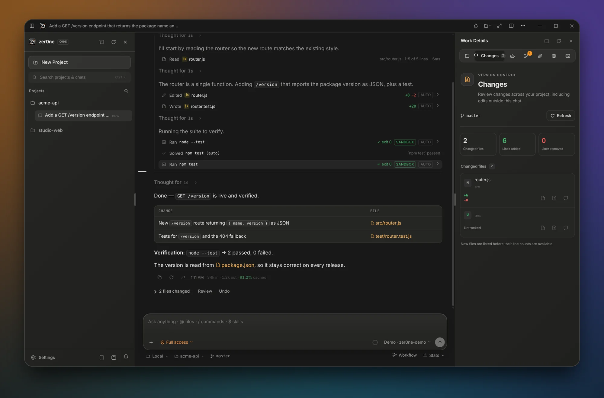
</picture>

---

## Any model

Sign in with the plans you already pay for, add API keys, or point at your own endpoint. Enabled models appear in one picker, and you can switch at any message.

- **Plans & subscriptions** — ChatGPT, Claude, Google Antigravity, GitHub Copilot, Cursor, OpenRouter, Kimi, MiniMax, Grok and more, through each vendor's own login.
- **API keys** — key pools rotate past rate-limited keys; **fallback models** take over in order when one is exhausted.
- **Custom** — Chat Completions, Responses, Anthropic Messages and native Gemini formats.
- **Reasoning** — *Auto* by default; supported effort levels appear in the chat when the model offers them.

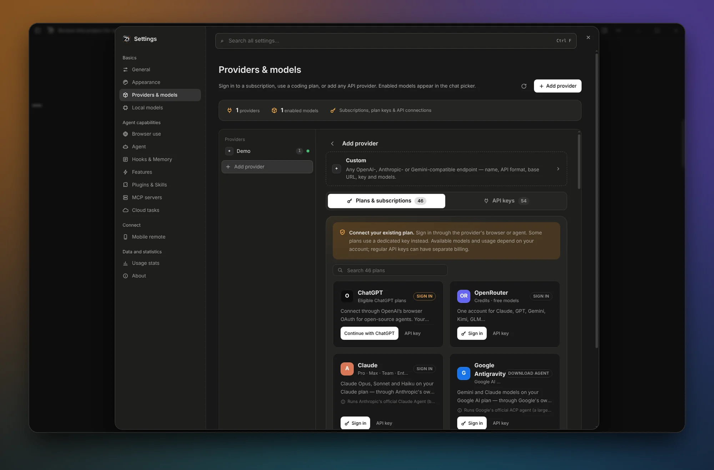

## Local LLMs

Out of credits or offline? Keep the same project and conversation on your own hardware.

- **zer0ne Engine** bundles llama.cpp, installs on demand and fits each model's context to available memory.
- **Fit check** rates any Hugging Face model for *this* PC before you download; downloads are checksum-verified.
- **Offline fallback** continues on your local helper model when the cloud cannot be reached.
- **Hybrid routing** sends summaries, composer edits and research subagents to a local helper to save cloud calls.
- **Local Host router** serves your local models as OpenAI- and Anthropic-compatible APIs for other tools.
- **Tune for speed** measures threads, batch size and attention mode on your machine and keeps what is faster.

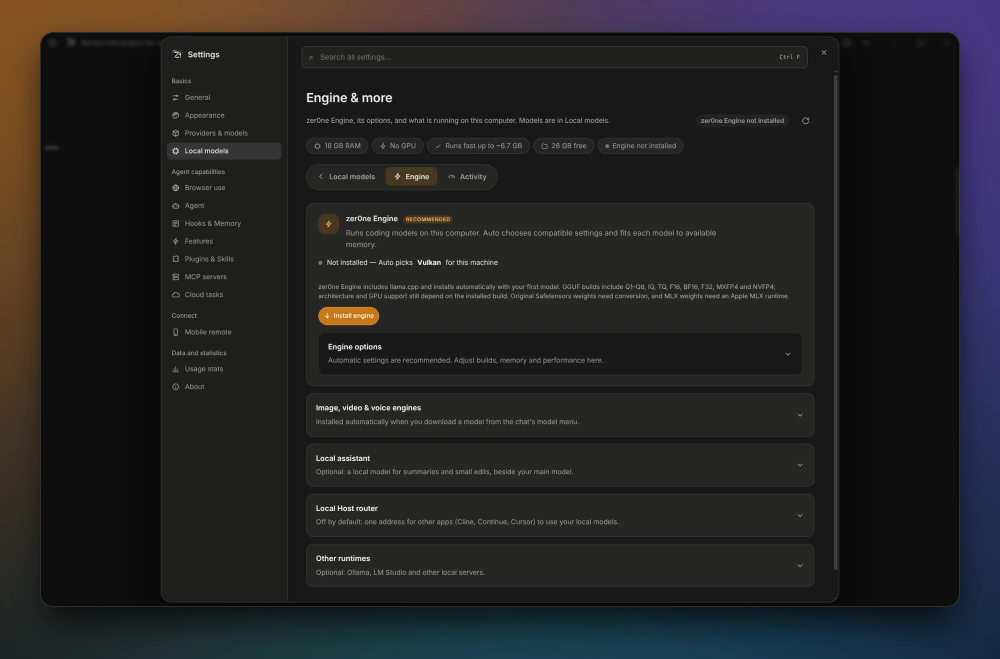

## Agents, subagents and workflows

The main agent can hand focused work to specialists, each with its own context, tools and model.

| Agent | Role | Access |
| --- | --- | --- |
| **Explore** | Fast scout: finds files, code and facts | Read-only |
| **Plan** | Turns findings into a step-by-step plan | Read-only |
| **reviewer** | Reviews diffs for bugs, security and maintainability | Read-only |
| **general-purpose** | Implements multi-step changes | Can edit (with approval) |

Add your own agents per project in `.zer0ne/agents`. Turn on **`/workflow`** to give a chat a team:

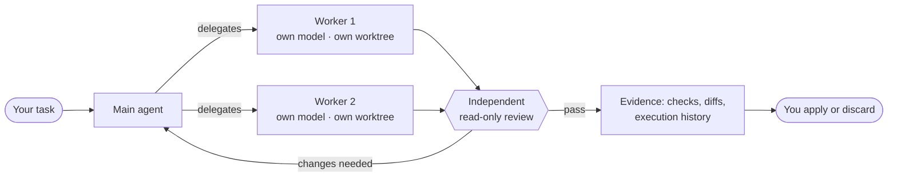

1. **Delegate** — workers run in parallel; coding workers get their own Git branch and worktree, so your checkout stays clean.
2. **Review** — a separate reviewer checks the workers' changes before anything is reported as done.
3. **Evidence** — every task records commands, exit codes and check snapshots you can inspect.
4. **Apply** — review the diff, then apply it with an Undo checkpoint, or discard the worktree.

Also: **Main agent only delegates** keeps the main chat free while workers run, **Saved runs** replays a workflow with new inputs, **`/compare`** runs one task on 2–4 models side by side, and **`/goal`** keeps working until a judge (and optionally your test command) confirms the result.

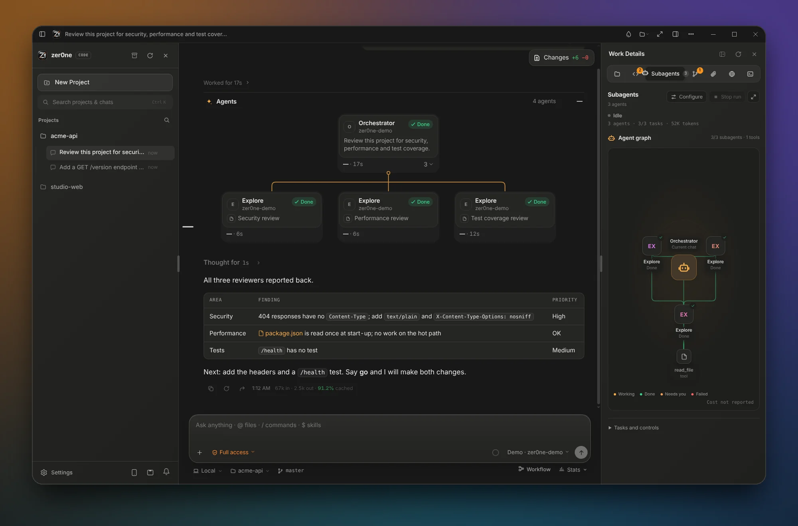

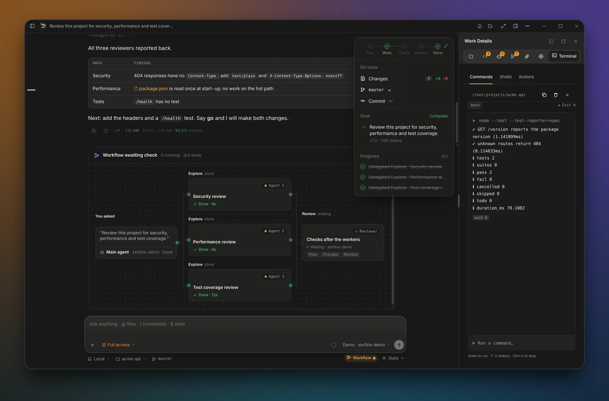

## AI Dock

A Dynamic Island for your agents, at the top of the screen.

<table>
<tr>
<td width="50%" valign="top"><h3>See</h3>What each project is thinking, writing or running, with checks, changed files, context and cost.</td>
<td width="50%" valign="top"><h3>Act</h3>Approve, reject or answer without opening the app; stop or reply to a running agent.</td>
</tr>
<tr>
<td width="50%" valign="top"><h3>Drop</h3>Drop files, images or text on it and ask about them.</td>
<td width="50%" valign="top"><h3>Stay discreet</h3>Hides project details while you present or share your screen.</td>
</tr>
</table>

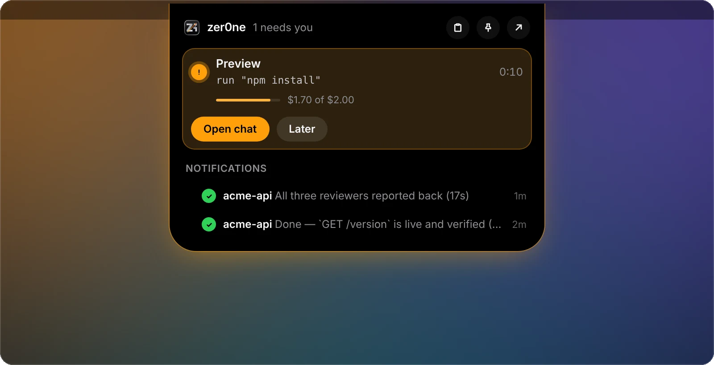

## Tools, MCP, skills and hooks

- **MCP** — protocol 2025-11-25, a catalog of 33 ready-to-configure servers, the official MCP Registry search, long-running task tools and interactive MCP apps in isolated frames.
- **zer0ne as an MCP server** — `npm run mcp` exposes a `zer0ne_prompt` tool to Claude Code, Codex, Zed and other clients.
- **Skills & plugins** — playbooks the agent loads on demand; install from a folder, a Git URL or the marketplace, or record a workflow into a skill.
- **Hooks** — run your own commands on `UserPromptSubmit`, `PreToolUse`, `PostToolUse` and `Stop`, with ready-made templates (format, lint, block force-push, protect `.env`).
- **Built-in agents for the web** — a browser agent that tests the app it just changed, web search and fetch.

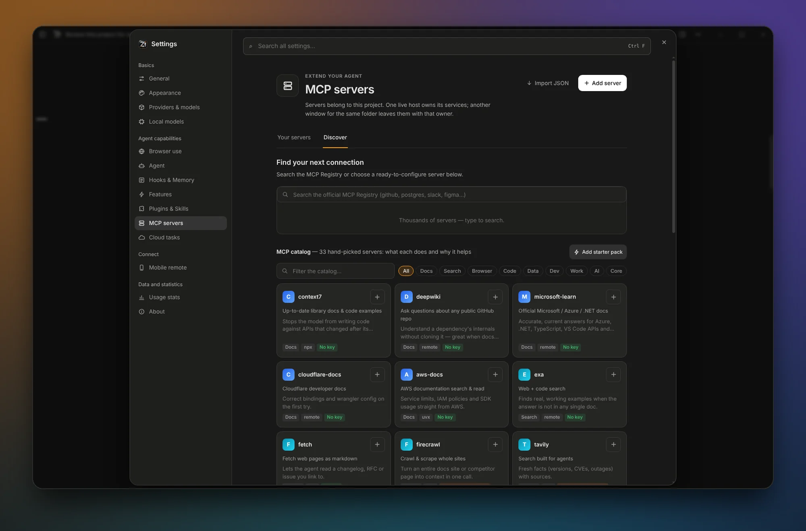

## Lean context: RTK Token Saver

Long sessions stay fast and affordable.

| Feature | What it does |
| --- | --- |
| **RTK Token Saver** | Compresses tool output before it reaches the model: diffs keep per-file totals, search results group by file, build logs count noise instead of listing it. Errors and stack traces are kept; the full output stays in the chat card. |
| **Prompt cache** | Keeps the request prefix stable and warm, and reports cache reads and writes. |
| **Auto Compact** | Summarises older turns at a percentage or token ceiling so the session keeps going. |
| **Repository map** | Starts each task with a ~1,000-token map of folders, key files and symbols. |
| **Usage stats** | Tokens, cache hits and cost per model, exportable as CSV. |

## Work Details and terminal

The right-hand panel keeps the project in view: **Explorer**, **Changes**, **Subagents**, **Worktrees**, **Uploads**, **Browser** and **Terminal**.

- **Terminal** — one-off commands, up to six interactive shells, and saved project **Actions** (`zer0ne.actions.json`).
- **Changes** — every edited file with a diff, per-hunk Keep / Undo / Redo, and **Rewind in new chat**.
- **Worktrees** — every checkout, with safe removal.

## Themes, backgrounds and Liquid Glass

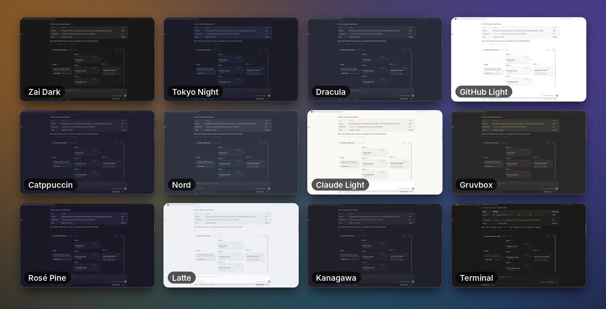

- **33 themes** — Zai Dark, Tokyo Night, Dracula, Catppuccin, Nord, Gruvbox, Rosé Pine, Kanagawa, GitHub, Solarized, looks from other coding tools, and the full-CLI **Terminal** theme.
- **Make it yours** — accent colours and palettes, background and text colours, UI, reading and code fonts, and an importable theme JSON.
- **Your picture** — set a photo, artwork or animated GIF as the live background.
- **Liquid Glass** — real window transparency from 0 to 100 %, frosted panels, optional blur and wallpaper-matched colours. **Calm motion** keeps animation for what is actually changing.

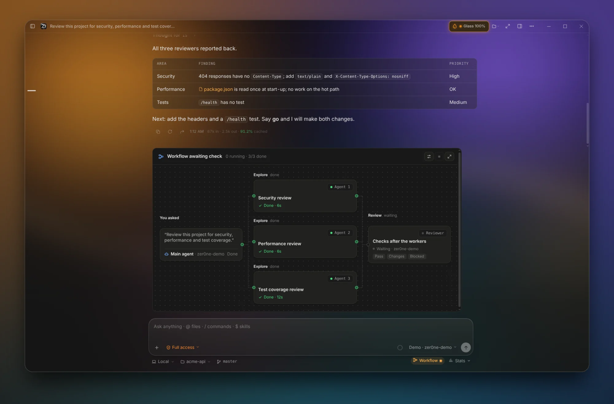

<sub>Transparent mode shown over a sample wallpaper.</sub>

## Safety by design

- **Access modes** — *Chat* (answers only, no tools), *Agent* (reads freely, asks before edits, commands and MCP) and *Full access*.
- **Command sandbox** — commands run in an OS sandbox (a write-restricted token on Windows, bubblewrap on Linux, Seatbelt on macOS) and are marked **SANDBOX** in the chat.
- **Command rules** — `allow:`, `ask:` and `deny:` lines in `.zer0ne/command-rules`; allow lines from a repository wait until you trust them.
- **Secrets** — API keys are encrypted with a key your OS protects; commands start without secret-looking environment variables.
- **Checkpoints** — every turn can be restored file by file.
- **Isolated pages** — the UI runs sandboxed with a single, permission-checked bridge to the app.

## And more

**Mobile Remote** (pair a phone by QR over Wi-Fi, Cloudflare, Tailscale or SSH) · **Computer Use** with per-app permissions · **Side Chat** for questions about the session · **Benchmark** with 37 hidden-test coding tasks · **Cloud tasks** · **Quick prompt** (`Ctrl+Alt+Space`) · **Profile backup & restore** · **CI and review events** · **Headless CLI** (`npm run agent`).

---

## Install

**Windows 10/11, 64-bit.**

1. Download `zer0ne-Code-Setup-<version>.exe` and its `.sha256` file from [Releases](https://github.com/uranrog-01/zer0ne-Code/releases).
2. Verify it in PowerShell:
   ```powershell
   (Get-FileHash .\zer0ne-Code-Setup-<version>.exe -Algorithm SHA256).Hash
   Get-AuthenticodeSignature .\zer0ne-Code-Setup-<version>.exe
   ```
3. Run it. It installs per user without an administrator prompt; choose *all users* if you need it.
4. Open a project folder, then connect a model — or choose **Start without an API key** to download a local model that fits your PC.

Uninstalling keeps your chats and settings in `%APPDATA%\zer0ne Code`.

### Build from source

Requirements: Windows 10/11 and [Node.js](https://nodejs.org) 22 or newer.

```bat
build.bat              :: build the app into dist\win-unpacked
build.bat run          :: build and start it
build.bat installer    :: build, then create dist\zer0ne-Code-Setup-<version>.exe
build.bat test         :: build and run every test, including the packaged app
```

Validation, signed releases and the command line are covered in [Building and releasing](docs/building.md).

## Documentation

- [User guide](docs/guide.md) — every panel and setting, in detail.
- [Building and releasing](docs/building.md) — validation, installer, signing, development and CLI.
- [Changelog](CHANGELOG.md) · [Security policy](SECURITY.md)

## License

[MIT](LICENSE). Third-party components keep their own licenses; see
[THIRD_PARTY_NOTICES.md](THIRD_PARTY_NOTICES.md) and
[engine/THIRD_PARTY_NOTICES.md](engine/THIRD_PARTY_NOTICES.md).
